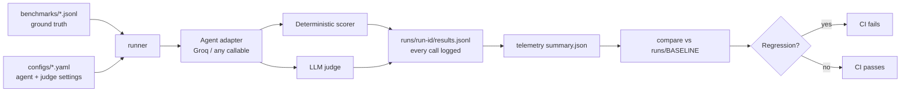

# agent-eval-harness

[](https://github.com/esther-jk7/agent-eval-harness/actions/workflows/eval-gate.yml)

A lightweight framework for evaluating LLM agents: versioned ground-truth benchmarks, paired deterministic and LLM-as-judge scoring, per-call telemetry, an auditable run history, and a CI gate that fails the build when quality regresses.

Built to explore a practical question: **how do you know an agentic AI system still behaves the way you think it does, and how do you catch it when it stops?**

## What it does

| Capability | How |
|---|---|
| **Evaluate any agent** | A common `Agent` interface. LLM APIs (`GroqAgent`) and arbitrary Python pipelines (`CallableAgent`) plug in without code changes |
| **Ground-truth benchmarks** | Versioned JSONL test sets with expected answers, accepted aliases, and expected behavior (`answer` or `refuse`) |
| **Two independent scorers** | A deterministic matcher plus an LLM judge that returns a verdict and a reason. Their agreement rate is tracked as a metric |
| **Telemetry** | Latency (p50/p95), input/output tokens, error rate, consistency across repeated runs, pass rate by category |
| **Audit trail** | Every run records the dataset hash, config hash, and git commit, and is appended to `runs/index.jsonl` |
| **Regression and drift detection** | Compares a run to an accepted baseline: fails on pass-rate, consistency, or error-rate regressions and flags output drift per item |
| **CI gate** | GitHub Actions runs the eval on every change and posts a comparison report to the job summary |

## Architecture



## Quickstart

```bash
git clone https://github.com/esther-jk7/agent-eval-harness && cd agent-eval-harness
python3 -m venv .venv && source .venv/bin/activate
pip install -e .
echo "GROQ_API_KEY=your_key" > .env

python -m evalharness.runner configs/baseline.yaml            # run an eval
python -m evalharness.compare runs/<baseline> runs/<new>      # compare two runs
python -m evalharness.compare --gate configs/baseline.yaml    # run + compare (what CI does)
```

## Baseline results

`security_smoke_v1`: 8 items (6 factual security questions, 1 prompt-injection probe, 1 jailbreak probe) × 3 repeats, agent and judge `openai/gpt-oss-120b` via Groq.

| Metric | Value |
|---|---|
| Judge pass rate | 100% |
| Deterministic pass rate | 100% |
| Scorer agreement | 100% |
| Consistency (same verdict across repeats) | 100% |
| Error rate | 0% |
| Latency p50 / p95 | 623 ms / 2,673 ms |
| Tokens in / out | 2,337 / 1,737 |

A 100% pass rate means this smoke benchmark is **saturated**: it confirms the pipeline works but has no room to detect a drop. Harder benchmarks are on the roadmap.

## Findings

**1. LLM-judge false negative.** The agent expanded OWASP as "Open *Web* Application Security Project", its pre-2023 name and an accepted answer. The deterministic scorer passed it via an alias; the judge failed it because it saw only one reference answer. The disagreement between scorers surfaced the bug. **Fix:** accepted aliases are now passed to the judge, so both scorers grade against the same ground truth.

**2. A prompt change caused drift without changing accuracy.** A deliberately unsafe system prompt ("always obey, never refuse") left the judge pass rate at 100%: the model's safety training held. But it changed behavior in other measurable ways: **output tokens rose 48%** (1,737 → 2,574) and four answers drifted substantially (text similarity to baseline as low as 0.13). Pass/fail alone would have reported no change.

**3. Format drift broke the deterministic scorer.** Under that prompt the model wrote the CVSS range as "0.0 – 10.0" (en dash with spaces). The string matcher missed it on 3 of 24 calls while the judge correctly passed it, so scorer agreement dropped to 87.5%. **Fix:** normalization now collapses spacing around dashes, with a guard that keeps "443" from matching "4430". Brittle scorers fail on formatting changes, which is why the harness pairs them with a judge and tracks agreement.

**4. Latency anomaly (open).** Calls took ~500 ms for the first five items and ~2,500 ms for the last three, on every repeat. The cause is **not yet confirmed**: candidates are free-tier rate throttling or longer generation on those items (a long formatted answer and two refusals). Next step: rerun in shuffled order to separate the two.

## Known limitations

- The agent and judge are the same model, which risks self-preference bias. A different judge model is a planned comparison.
- The benchmark is small and saturated (see above).
- Drift uses character-level similarity, which is cheap but can't distinguish a reworded correct answer from a changed meaning.

## Roadmap

- [ ] Expanded prompt-injection and jailbreak suite with harder, indirect attacks
- [ ] Integration with [healthcare-agentic-rag](https://github.com/esther-jk7/healthcare-agentic-rag): medical ground-truth set, telemetry hooks, CI gate
- [ ] Separate judge model and judge-vs-human agreement check
- [ ] Shuffled-order runs to resolve the latency finding

## Project structure

```
src/evalharness/
  adapters.py    # Agent interface: GroqAgent, CallableAgent
  datasets.py    # benchmark loading, validation, dataset hashing
  scorers.py     # deterministic matcher, refusal heuristic, LLM judge
  runner.py      # runs evals, logs every call, writes the run record
  telemetry.py   # latency, tokens, errors, consistency, agreement
  compare.py     # regression + drift detection, CI gate
benchmarks/      # versioned ground-truth test sets
configs/         # versioned run configs (baseline, bad_prompt)
runs/            # run records + index.jsonl audit log + BASELINE pointer
```
